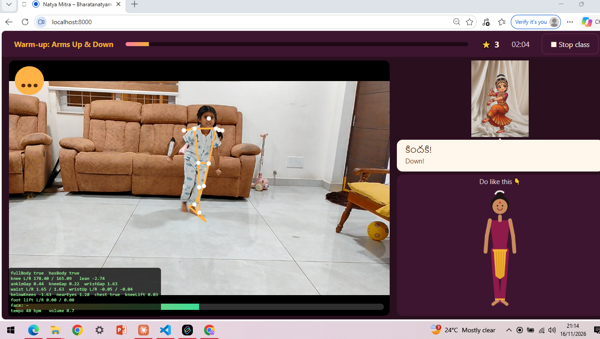
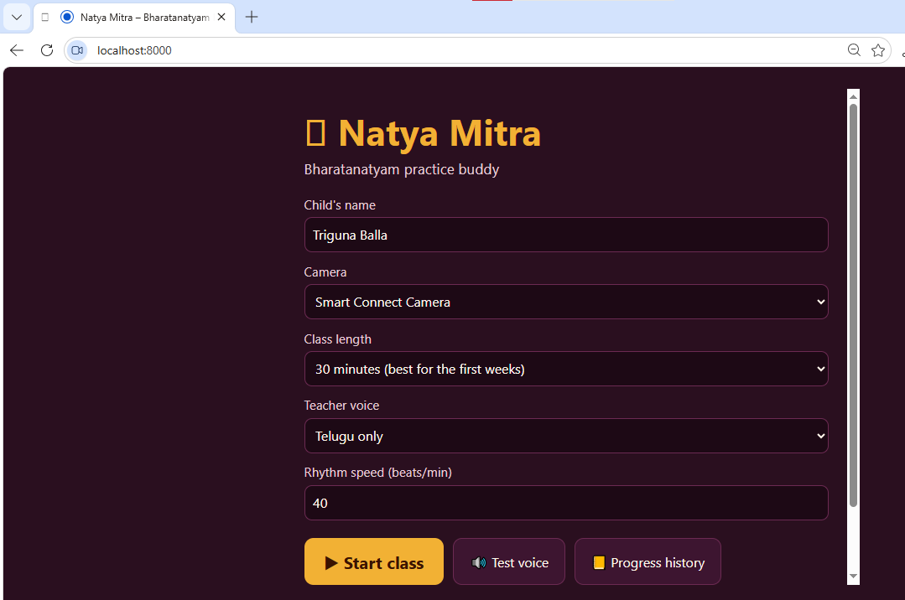
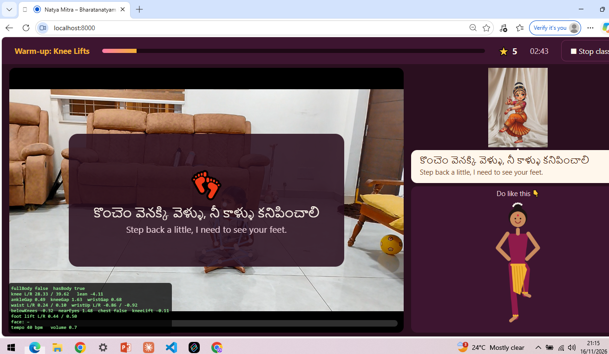
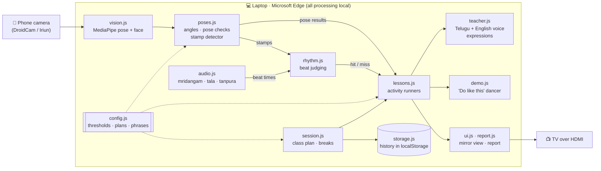

# 
 Natya Mitra – Bharatanatyam practice buddy

**Natya Mitra** ("dance friend") is a browser app that helps young children, from about 4 years old, practise beginner Bharatanatyam at home.

A phone camera watches the child, and a skeleton overlay is drawn on a mirror view of them. An animated teacher talks to them in **Telugu and English**, and a *"Do like this"* dancer shows each pose. The app plays mridangam, Adi talam claps and tanpura for rhythm practice. At the end of class the child gets stars and stickers, and the parent gets a summary.

> 🔒 **Privacy first:** all video is processed on the laptop and nothing is uploaded or recorded. The internet is only used to download the tracking models and for Edge's Telugu voice.



---

## ✨ Features

- **Live pose tracking** with MediaPipe Pose and Face Landmarker, running in the browser (GPU first, with a CPU fallback).
- **Bilingual teacher:** spoken prompts in Telugu, English, or both, with an animated SVG face that changes expression.
- **"Do like this" demo dancer** that animates every step.
- **Gentle corrections only:** at most one hint every 6 seconds, never negative words, and a knee-safety check in Aramandi.
- **Rhythm training:** synthesized mridangam (thom/tha/nam), Adi talam kriya and tanpura. Foot stamps are judged against the beat, and the tempo adapts automatically.
- **Smart class flow:** 30, 45 or 60 minute plans, automatic water breaks, and a rest when the child seems tired.
- **Reports:** stars and stickers for the child, a parent summary with scores and common corrections, and progress history that you can export as CSV or JSON.
- **No build step:** plain JavaScript ES modules and a simple local server.

---

## 📸 Screenshots

### 1. Start screen
Enter the child's name, choose the camera, class length, teacher voice language and starting rhythm speed.



### 2. During class
The mirror view has a skeleton overlay. The teacher speaks in Telugu with English subtitles, and the demo dancer shows the move. The green panel is the parent's **D** debug overlay with live measurements for tuning.

| Warm-up: arms up and down | Gentle framing prompt |
|---|---|
|  |  |
| The child follows the dancer while the app checks the pose. | When the feet go out of view, the teacher kindly asks the child to step back. |

### 3. Post-session report
Stars and stickers for the child, then a parent summary: minutes, overall score, stamps on beat, tempo and breaks. It also lists what went well, what to practise next, and the most common corrections.


A table for each activity shows the score, stars and details. You can download the report as JSON or print it.


### 4. Progress history
Every class is saved locally in the browser and can be downloaded as CSV.


---

## 🧘 What a class contains

| Activity | What she does |
|---|---|
| **Welcome** | The app checks that the camera can see her whole body. |
| **Warm-up** | Arms up and down, side bends, knee lifts, toe touches. |
| **Namaskaram** 🙏 | Hands together, touch the floor, touch the eyes, hands together. |
| **Samapadam** | Feet together, knees straight, hands on waist. Held for 4 seconds. |
| **Aramandi** | Knees bent and turned out, heels together. It warns "not so low" to protect her knees. |
| **Tatta Adavu** 👣 | "Thai ya Thai hi" stamps, alternating right and left, with mridangam, claps and tanpura. It starts at 40 BPM and goes up by 4 when she gets 70% or more of the beats. Her speed is remembered for next time. |
| **Face game (Abhinaya)** 😊 | Smile, surprised, sad, then eyes side to side. She needs to be within about 1.5 m of the camera. |
| **Breaks** | A planned water break, an automatic one if 15 minutes pass without one, and a rest if two activities in a row go poorly. |
| **Closing Namaskaram** | Then the report. |

---

## 🏗️ Architecture

Everything runs in the browser on the laptop: plain JavaScript modules, no build step, no server-side code.



**How one moment of class flows:**
1. A camera frame goes to `vision.js`, which finds body landmarks.
2. `poses.js` turns them into angles and checks the pose, or detects a foot stamp.
3. `lessons.js` decides what happens next: praise, a gentle hint from the teacher, the demo dancer showing the move, or the next step.
4. In rhythm activities, `rhythm.js` compares stamps with the beats `audio.js` played.
5. `session.js` strings activities into a class, adds breaks, and saves the report.

---

## 🛠️ Hardware setup

```
 📱 Android phone ──USB / Wi-Fi──► 💻 Windows laptop (Edge) ──HDMI──► 📺 TV
   (DroidCam / Iriun)                 runs Natya Mitra             (Win+P → Duplicate)
```

1. **Phone as webcam**
   - Install **DroidCam** (or **Iriun Webcam**) on the Android phone, and its Windows client on the laptop.
   - Connect them over USB (less delay) or the same Wi-Fi.
   - Mount the phone in landscape at about waist height (80–100 cm), 2.5–3 m in front of her.
   - Her whole body, including her feet, must be in the picture.
   - Keep the phone on its charger.
2. **Laptop to TV:** connect with the HDMI cable, then press `Win + P` and choose **Duplicate**.
3. **Browser:** use **Microsoft Edge**, which has the natural Telugu voice "Shruti". Chrome usually has no Telugu voice, so the teacher falls back to English.
4. **Python:** install it from [python.org](https://www.python.org/) if `start.bat` can't find it. (Node.js also works.)

Tested on a Windows 10 laptop with 8 GB RAM and a 2 GB GPU.

---

## 🚀 Getting started

```bash
git clone https://github.com/satyaballas/natya-mitra.git
cd natya-mitra
start.bat
```

`start.bat` runs `python -m http.server 8000` and opens Edge at <http://localhost:8000>.

> ES modules need a server, so opening `index.html` directly (`file://`) won't work.

**Every class:**
1. Start the DroidCam (or Iriun) app on the phone and on the laptop.
2. Double-click **`start.bat`**.
3. Enter the child's name and choose the camera ("DroidCam Source" or "Iriun").
4. Pick **30 minutes** for the first weeks. Click **🔊 Test voice** once, then **▶ Start class**.

The first start downloads about 30 MB of models; after that it's quick.

### Parent keys during class

| Key | Action |
|---|---|
| `Space` | Pause / continue |
| `B` | Water break now |
| `N` | Skip to the next activity |
| `E` | End class and show the report |
| `+` / `−` | Rhythm faster / slower |
| `M` | Music on / off |
| `D` | Live measurements, for tuning |
| `F` | Full screen |

---

## 🎛️ Tuning for your child

Thresholds are set for an average child, so expect to adjust a few in the first week.

1. Press **D** during class to see live numbers: knee angles, gaps, smile score and so on.
2. Edit **`js/config.js`**, then reload the page:
   - `T.*` sets every pose threshold. Each one is commented.
   - `latencyMs` (default 150): raise it if stamps that sound on time are marked late, lower it if they're marked early.
   - `PHRASES` holds everything the teacher says. Change the Telugu to match how her teacher talks.
   - `plans` and `activities` set the order, repetitions and hold times.
3. If something is too hard, raise the tolerance. Praise matters more than precision at age 4–5.

**Tips**
- Leggings or practice pyjamas work best. A loose frock hides the knees from the camera.
- Light the child from the front, not from a window behind them.
- Use a floor that isn't slippery. Bare feet are best.
- Sit with them for the first few classes. Children copy a parent who joins in.

---

## 🧪 Tests

```bash
node tests/test_logic.mjs
```

These are pure Node tests: the real `poses.js` and `rhythm.js` logic is checked against the demo dancer's keyframes.

For debugging in the browser console, `window.natya` exposes `demo`, `teacher`, `ui`, `progress`, `session` and `metrics`.

---

## 📁 Project structure

```
index.html             screens and teacher artwork
start.bat              local server + Edge launcher
css/style.css          TV layout
js/config.js           ← settings, lesson plan, phrases (edit this)
js/vision.js           MediaPipe pose + face tracking
js/poses.js            pose and face checks, stamp detector
js/rhythm.js           beat judging
js/audio.js            synthesized mridangam, tala, tanpura
js/teacher.js          voice and expressions
js/demo.js             "Do like this" dancer
js/demo_poses.js       dancer keyframes
js/lessons.js          activity runners
js/session.js          class flow, breaks, report data
js/ui.js               screens and render loop helpers
js/report.js           report and history screens
js/storage.js          localStorage history
js/main.js             boot and parent keys
tests/test_logic.mjs   logic tests
screenshots/           images used in this README
```

---

## ⚠️ Known limits (v1)

- Stamps are detected from the camera (foot lift and land), not the microphone.
- Mudras (hand gestures) aren't included yet.
- Adavus are done standing. Stamping in Aramandi comes in a later level.
- Thresholds are still being tuned with real sessions.

## 🗺️ Roadmap

- [ ] Tune thresholds from real-session data
- [ ] Use the phone mic to sharpen stamp timing, with vision deciding which foot
- [ ] Mudras with MediaPipe HandLandmarker (Pataka, Tripataka…)
- [ ] Adavus in Aramandi, Tatta Adavu 2+, and levels and unlocks
- [ ] A clap-along calibration to set `latencyMs` automatically
- [ ] Progress charts, the teacher's name and custom stickers

---

## 📄 License

The code and the cartoon teacher artwork are released under the [MIT License](LICENSE).

**Exception:** the images in [`screenshots/`](screenshots/) show a real child and are **not** covered by the MIT License. All rights to them are reserved, so please don't reuse them.

---

## 🙏 Acknowledgements

- [MediaPipe Tasks Vision](https://developers.google.com/mediapipe) for pose and face landmark detection.
- Microsoft Edge's natural voices for Telugu (Shruti) and Indian English (Neerja).
- Made with love for a little dancer. 🪷
